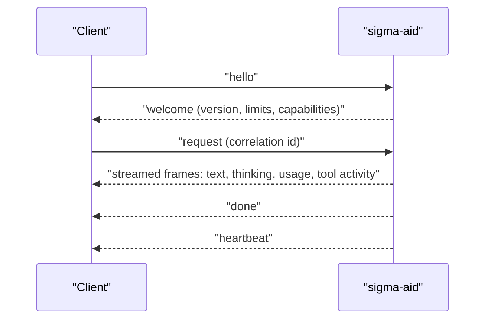

# Clients

## The protocol

A client opens the daemon's Unix domain socket and exchanges typed frames. Each frame is a length prefix, an 8-byte header with a kind, an operation and a correlation id, and a JSON body. On connect the client sends a hello and the daemon answers with a welcome that states the protocol version, the frame size limit and the daemon's capabilities. The daemon closes a connection whose protocol major version it does not support. While a connection is open the daemon sends heartbeat frames, and one connection can carry many requests at the same time.



## Python client

The Python client, `sigma_aid_client`, needs Python 3.8 or newer and no other package. It is the reference client: its operation list is generated from the daemon's own route table, so the two cannot drift apart. The client addresses the daemon's office rather than a provider: you name a position (`to="coder"`), a staff member (`to="amanda"`), or nothing for the default assistant, and the daemon chooses the model. Pass the socket path to `Client(path)`; the default is `$XDG_RUNTIME_DIR/sigma-ai.sock`, or `/tmp/sigma-ai.sock` when that variable is not set.

```python
from sigma_aid_client import Client

with Client("/run/sigma-aid/sigma-aid.sock") as ai:
    reply = ai.ask("Summarise this dataset in three bullet points")
    print(reply.text)
    reply = ai.ask("Refactor parse.py to remove the global", to="coder")
```

The client also offers an `AsyncClient` with the same surface, multi-turn conversations held by the daemon, streaming callbacks, and a domain object for each protocol kind (`sessions`, `memory`, `credentials`, `configuration` and others).

The same package ships `sigma_aid_mcp`, an MCP server that exposes a running daemon's memory, sessions and chat as MCP tools. Run it with `python3 -m sigma_aid_mcp --socket <path>` and register it with any MCP client.

## Julia client

The Julia client, `SigmaAID.jl`, is one file. It needs Julia 1.11 or newer and the `JSON` package. It speaks the same protocol: hello and welcome on every connection, typed reads of providers, tools, agents and sessions, streamed turns, client-hosted tools and cancellation. The default socket is `/tmp/sigma-ai-<user>.sock`; set `SIGMA_AID_SOCKET` to change it. A turn must name a provider, because the daemon does not resolve a default for a raw submit.

```julia
include("SigmaAID.jl"); using .SigmaAID
c = Client()
chat(c, [Dict("role" => "user", "content" => "hi")]; provider = "zai")
```

In an interactive session, `using .SigmaAID` also installs an `ai>` console: press `}` at an empty `julia>` prompt. The file `smoke.jl` runs a five-stage check against a live daemon.

## sigma-ide

The sigma-ide editor connects to the same socket. It is the usual way to add connections, store credentials and chat with the daemon. See the [sigma-ide section](/sigma-ide/).
