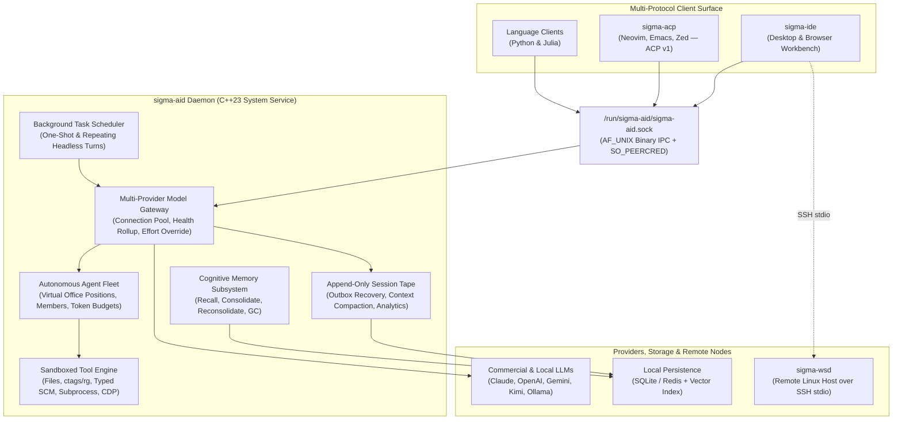

# sigma-aid Major Features and Architecture

`sigma-aid` is the core background daemon of the Sigma AI platform. Written in modern C++23, it runs as a system service under a dedicated service account and provides multi-model routing, durable append-only session persistence, multi-layered memory consolidation, sandboxed tool execution, background scheduling, and multi-protocol client multiplexing over a local `AF_UNIX` domain socket (`/run/sigma-aid/sigma-aid.sock`).

It is not an unauthenticated localhost HTTP server: clients connect over the Unix domain socket with kernel peer authentication (`SO_PEERCRED`), while provider credentials, session tapes, and tool authority stay inside the daemon boundary.

## 1. Multi-Provider LLM Routing and Model Orchestration

`sigma-aid` decouples interactive clients and agent workflows from individual vendor SDKs, exposing a single normalized model gateway with live connection telemetry and per-task routing controls.

### Unified Model Gateway

Provides a single, normalized interface to commercial cloud providers (**Anthropic Claude**, **OpenAI**, **Google Gemini**, **Moonshot Kimi**, **xAI**, **DeepSeek**) 
and local or LAN inference backends (**Ollama** and OpenAI-compatible local servers).
Both OAuth subscription connections and metered API key connections are addressed by logical route names rather than hardcoded vendor endpoints. 
**Multiple connections** to an endpoint are supported.

### Connection Pooling and Cached Health Rollup

Maintains an immutable connection inventory (`connections`), observed health states (`daemon_health`), principal-scoped redacted credential readiness, and dynamic model rosters (`models`) in memory. Control-plane queries read directly from cached telemetry without performing socket I/O, credential refreshes, or live vendor polling.

### Granular Per-Task Model and Effort Override

Workflows and delegations (`delegate_position`, `delegate_member`, and session turns) can dynamically select or override the `provider`, `model`, and reasoning `effort` (`minimal`, `low`, `medium`, `high`, `xhigh`, `max`) for a single task without mutating the agent's default configuration. Refused overrides fail explicitly rather than silently falling back to an unintended model.

### Token Accounting and Usage Rollup

Tracks `input`, `output`, `cache_read`, and `cache_write` tokens per turn, per session tape, and cumulatively across the daemon (`spend_report`, `resource_status`, `session_stats`), pairing token counters with configured model price metadata and subscription quota windows (`5h` and `weekly`).

---

## 2. Durable Session Management and Tape Persistence

Every conversation in `sigma-aid` is backed by an append-only event log rather than fragile in-memory browser state.

### Append-Only Event Tape

Every user prompt, model request, streamed response, raw tool call, tool output, delegation event, cancellation, and token usage record is appended to an immutable session tape stored on disk in **SQLite** or **Redis**.

### Crash Resilience and Deterministic Replay

If a client disconnects, the browser tab closes, or the daemon restarts mid-session, the full conversation state, message history, and structured tool execution records are replayed deterministically from the session tape (`session_read`, `session_status`, `session_transcript`) without losing completed work.

### Bounded Context Compaction (`tool_result_read`)

To prevent large file reads, build logs, or search outputs from exhausting the model's context window, `sigma-aid` automatically compacts oversized historical tool results into lightweight placeholders carrying a `tool_call_id`. The full payload remains on the tape and can be retrieved on demand via `tool_result_read`.

### Deterministic Model-Free Analytics

Built-in inspection tools compute exact operational metrics directly from the session tape without calling an LLM:

- **`session_stats`**: Counts requests, answers, failed turns, cancellations, tool calls by tool and failure category, delegated calls by agent, and token totals across a cursor-bounded span.
- **`tape_analytics`**: Derives failure categories, failures by tool and agent, and queued-to-end lifetime distributions for delegated tasks.
- **`session_status` & `session_transcript`**: Inspects whether any assistant turn is still open, counts outstanding tool calls, and renders bounded human-readable briefings.

---

## 3. Autonomous Agent Fleet and Role Delegation

Rather than routing every problem through a single generalist prompt, `sigma-aid` coordinates a structured fleet of role-specialized agents.

### Specialized Virtual Office Roster

Supports pre-configured positions (`roles.conf`), named staff personas (`personalities.conf`), and organisational hierarchies (`office.conf` / `agents.conf`), including `director`, `architect`, `coder`, `reviewer`, `explorer`, `researcher`, `integrator`, `ux`, `marketing`, `sales`, `socials`, `desk`, and `phone`. Boot-time fleet assignments are inspectable at runtime via `fleet_roster`.

### Hierarchical Position and Member Delegation

Primary agents delegate subtasks by office position (`delegate_position`, where the daemon selects the holder and enforces the position's tool filter and skill allowlist) or by named staff member (`delegate_member`, optionally wearing a specific position). Human members listed in the office are never dispatched autonomously—targeting a human-held role returns an explicit escalation naming who to ask directly.

### Cross-Thread Fleet Telemetry and Budget Gates

`fleet_status` provides live, cross-thread-safe telemetry on daemon-wide in-flight child delegations, concurrency capacity, ready/busy states, recursion depth limits (`agent_max_depth`), and root token budgets (`agent_token_budget` and `turn_output_token_budget`).

---

## 4. Multi-Layered Memory Subsystem

`sigma-aid` bridges immediate session state with durable cross-session knowledge through a structured cognitive memory lane.

### Categorized Memory Records (`remember`)

Stores distilled single-topic records across `semantic`, `procedural`, `episodic`, `summary`, `decision`, and `fact` kinds. Each record carries a scope, searchable tags, a floating-point importance score (`0.0` to `1.0`), and an explicit verification state. Oversized inputs are automatically atomized into single-topic entries.

### Sub-Millisecond Indexed Retrieval (`recall`)

Queries long-term memory across the active project scope or global store using vector embeddings and indexed tags, returning matching records with their kind, importance, and verification status.Verified durable memories are injected into rallies automatically.

### Consolidation, Reconsolidation, and Garbage Collection

- **`consolidate`**: Synthesizes recent conversational turns into durable facts, procedures, and summaries using a configured background synthesizer.
- **`reconsolidate`**: Compacts near-duplicate derived memories by merging overlapping records so long-running projects do not accumulate redundant state.
- **`gc_memory`**: Garbage-collects rejected records and aged low-importance memories according to `max_age_days` and `min_importance` thresholds.

### Maintenance Authority and Verification Gating (`verify_memory`)

Newly recorded candidate memories are not injected as verified truth until confirmed via `verify_memory`. Verification is restricted to the daemon's maintenance authority, preventing unverified model output from automatically poisoning long-term project memory. Outdated memories can be removed immediately with `forget`.

---

## 5. Sandboxed Tool Execution and System Integration

Models never touch the host operating system directly; every side effect passes through `sigma-aid`'s typed, permission-gated tool engine.

### File, Search, and Code Navigation Engine

- **File Operations (`read_file`, `write_file`, `edit`, `multi_edit`, `multi_file_edit`, `apply_patch`, `list_dir`, `glob`)**: Enforces a strict **read-before-edit** invariant in the session, validates exact substring anchors, and writes files via atomic rename so readers never observe a partially written file.
- **Fast Search & Symbol Indexing (`ripgrep_search`, `search`, `tag_search`, `file_tags`)**: Combines regex/literal workspace search with `universal-ctags` symbol definitions and per-file outlines across ~150 languages.

### Typed Version Control (SCM) and GitHub Lifecycle

- **Structured Git (`git_status`, `git_diff`, `git_log`, `git_show`, `git_checkout`, `git_commit`, `git_push`, `git_stash`, `git_reset`)**: Operates on explicit workspace-relative repository paths. Every `git_reset` captures the pre-reset tip under `refs/scm/backup/reset/` before moving `HEAD`, making even hard resets undoable via `git_backup_list` and `git_backup_restore`.
- **Pause-Safe History Rewrites (`git_rebase`, `git_rebase_plan`, `git_rebase_apply`, `git_cherry_pick`, `git_revert`, `git_conflicts`, `git_conflict_resolve`, `git_reconcile`)**: Pauses cleanly on merge conflicts instead of leaving a half-applied index, and re-derives repository state from markers via `git_reconcile` if a subprocess times out.
- **GitHub Integration (`gh_issue_list`, `gh_issue_comment`, `gh_pr_list`, `gh_pr_view`, `gh_pr_create`, `gh_pr_comment`, `gh_pr_merge`)**: Manages issues and pull requests under the daemon user's configured credentials.

### Build, Test, Background Processes, and Web Research

- **Build & QA (`build`, `run_tests`, `run_linter`, `evaluate_code`)**: Executes project builds, test suites, linters, and short code snippets inside the confined workspace root with structured pass/fail summaries.
- **Background Process Manager (`exec_start`, `exec_status`, `exec_output`, `exec_kill`)**: Launches long-running builds, test runners, or servers asynchronously and returns a handle immediately, streaming bounded stdout/stderr via byte-cursor pagination and terminating the process group cleanly on session end.
- **Web & SERP Research (`web_search`, `serp_search`, `web_fetch`)**: Runs paid search queries (DataForSEO with explicit per-call `cost_usd` reporting) and extracts HTTPS pages into clean Markdown, plain text, or raw HTML.

---

## 6. Schedulers and Daemon Automation

`sigma-aid` includes a persistent scheduler so recurring engineering and operational tasks run even when no interactive editor is open.

### One-Shot and Repeating Schedules (`schedule`)

Schedules prompts to fire at an exact ISO-8601 / epoch-millisecond timestamp (`at`) or after a relative delay (`in_seconds`), with optional repeating intervals (`every_seconds`, minimum 60 seconds). Active jobs are inspectable via `schedule_list` and cancellable via `schedule_cancel`.

### Headless Transcript Execution

At the due moment, the daemon fires the scheduled record as a normal turn with no interactive client attached, appending the full execution trace and final answer directly to the target session tape. Repeat intervals missed while a machine was powered off are skipped rather than replayed in a burst.

### Principal-Scoped and Administrative Identity

Scheduled jobs run under the creating caller's identity and permissions by default, while administrative callers may opt into daemon identity (`as_daemon: true`) with the stored identity recorded explicitly in the schedule receipt.

---

## 7. Multi-Protocol Client Surface

`sigma-aid` serves desktop, terminal, browser, and scripting environments through purpose-built protocol adapters:

| Client / Adapter | Transport & Protocol | Primary Use Case |
|---|---|---|
| **[sigma-ide](/sigma-ide/)** | `AF_UNIX` binary multiplexed IPC (`/run/sigma-aid/sigma-aid.sock`) | Full desktop and browser AI IDE with Agent Activity tree, Working Tree diffing, Commit Graph, and live quota status bar. |
| **[sigma-acp](/sigma-aid/sigma-acp/)** | `stdio` JSON-RPC 2.0 (ACP v1 `schema-v1.23.0`) ↔ `AF_UNIX` socket | Connects **Neovim**, **Emacs**, and **Zed** with streaming tokens, dynamic model switching, editor-hosted `acp__*` MCP tools, and plain-text Markdown rendering. |
| **[sigma-wsd](/sigma-aid/sigma-wsd/)** | Encrypted `ssh` `stdio` pipe (8-byte multiplexed binary frames) | Zero-port remote Linux workspace agent (~3 MB RSS) providing `openat2`-confined file I/O, atomic writes, and recursive `inotify` watching. |
| **Browser Automation (`chrome-devtools`)** | Chrome DevTools Protocol (CDP) via MCP bridge | Headless or visible browser control: accessibility tree snapshots, DOM interaction, network/console inspection, performance traces, and Lighthouse audits. |
| **[Python & Julia Clients](/sigma-aid/clients/)** | `AF_UNIX` binary IPC client libraries | Programmatic automation, notebooks, custom evaluation harnesses, and batch data workflows. |

---

## 8. Security and Isolation Model

`sigma-aid` enforces defense-in-depth across socket authentication, filesystem access, subprocess execution, and destructive actions:

| Boundary | Enforcement Mechanism |
|---|---|
| **Kernel Peer Authentication (`SO_PEERCRED`)** | Every client connection on `/run/sigma-aid/sigma-aid.sock` is verified against the Linux kernel's peer credentials (`uid`/`gid`) against `main.allow_uids` and `main.admin_uids` before any frame is processed. |
| **Per-Role Tool Grants & Workspace Confinement** | Read, write, subprocess (`exec`), and git authority are separate configuration grants. File paths are resolved relative to the workspace root using descriptor-relative checks (`openat2` / `O_NOFOLLOW`) to block symlink and `../` traversal escapes. |
| **Interactive Operator Gating (`approve_action` / `ask_user`)** | High-blast-radius operations—such as `gh_pr_create`, `gh_pr_merge`, `git_reset`, rebases, branch deletions, or worktree removals—pause the turn for explicit user confirmation. A timeout or unanswered prompt always resolves to **declined**, never consent. |
| **Sanitized Subprocess & Secret Hygiene** | Child processes run with a sanitized environment, credential stores (`secrets.conf`) are locked to `0600` under the service account, `.env` and secret files are excluded from commits, and wire frame buffers enforce strict byte and concurrency caps. See **[Security & User Isolation](/sigma-aid/security/)** for the complete threat matrix and `systemd`/ACL/egress hardening guide. |

---

## 9. Documentation Map

| Guide | What it covers |
|---|---|
| **[Install and run](/sigma-aid/install/)** | Installing `sigma-aid` from the `.deb` package, the `apply-recipe` ledger, and the browser Setup Wizard (`127.0.0.1:8742/wizard`). |
| **[Configuration](/sigma-aid/configuration/)** | `/etc/sigma-aid/` configuration files (`config.conf`, `agents.conf`, `roles.conf`, `office.conf`, `personalities.conf`, `models.conf`). |
| **[Providers and keys](/sigma-aid/providers-and-keys/)** | Setting up OAuth subscriptions and API keys in `secrets.conf`. |
| **[Tools, MCP and skills](/sigma-aid/tools-mcp-skills/)** | Native tool permissions, external MCP servers, and operator-approved Agent Skills. |
| **[sigma-wsd](/sigma-aid/sigma-wsd/)** | Architecture and wire protocol of the C++23 remote workspace daemon over SSH `stdio`. |
| **[sigma-acp](/sigma-aid/sigma-acp/)** | Architecture and protocol lifecycle of the Agent Client Protocol adapter for Neovim, Emacs, and Zed. |
| **[Security & User Isolation](/sigma-aid/security/)** | Threat matrix for dedicated system user (`ai`) vs. developer UID, lateral workspace poisoning, and `systemd`/ACL/egress hardening. |
| **[Clients](/sigma-aid/clients/)** | Connecting `sigma-ide`, Python, and Julia to `/run/sigma-aid/sigma-aid.sock`. |
| **[Licensing](/sigma-aid/licensing/)** | Licence file locations and terms. |
