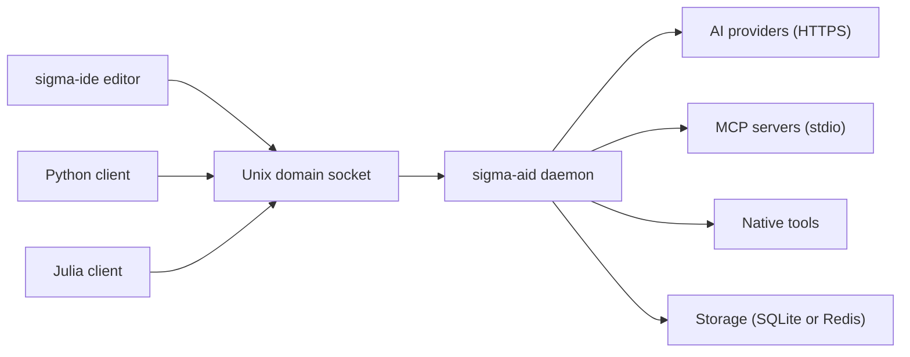

# sigma-aid

sigma-aid is a daemon that runs on your machine and talks to AI providers for you. Clients such as the sigma-ide editor, the Python client and the Julia client connect to it over a Unix domain socket. The daemon holds the provider credentials, routes each request to a provider and model, runs tools on behalf of the model, and keeps sessions and memory in local storage. It is not an HTTP or REST server; the socket is the only client interface.

## Pages in this section

| Page | Content |
|---|---|
| [Install and run](/sigma-aid/install/) | How to start the daemon and what it needs. |
| [Configuration](/sigma-aid/configuration/) | The configuration directory and its files. |
| [Providers and keys](/sigma-aid/providers-and-keys/) | How to store your own provider credentials. |
| [Tools, MCP and skills](/sigma-aid/tools-mcp-skills/) | Native tools, MCP servers and Agent Skills. |
| [Clients](/sigma-aid/clients/) | The Python and Julia clients and the editor. |
| [Licensing](/sigma-aid/licensing/) | Where the licence rules are. |
