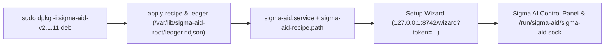

# Install and run `sigma-aid`

`sigma-aid` ships as a Debian package (`sigma-aid-v<version>.deb`). Installing the package creates the dedicated service account and shared workspace tree, grants your user account permission to connect and configure the daemon, starts `sigma-aid.service`, and opens the browser Setup Wizard to finish onboarding.



## 1. Install the Debian package

Run `dpkg -i` on the downloaded `.deb` archive using `sudo`:

```text
steven@gauss:~$ sudo dpkg -i sigma-aid-v2.1.11.deb 
Selecting previously unselected package sigma-aid.
(Reading database ... 738217 files and directories currently installed.)
Preparing to unpack sigma-aid-v2.1.11.deb ...
Unpacking sigma-aid (2.1.11) ...
Setting up sigma-aid (2.1.11) ...
applied {"kind":"group","name":"ai"}
applied {"kind":"group-member","group":"ai","user":"sigma-aid"}
applied {"kind":"group-member","group":"render","user":"sigma-aid"}
applied {"kind":"dir","path":"/var/lib/ai","owner":"sigma-aid:ai","mode":"0710"}
applied {"kind":"dir","path":"/var/lib/ai/projects","owner":"sigma-aid:ai","mode":"2770"}
applied {"kind":"dir","path":"/var/lib/ai/projects/repos","owner":"sigma-aid:ai","mode":"2770"}
applied {"kind":"dir","path":"/var/lib/ai/projects/worktrees","owner":"sigma-aid:ai","mode":"2770"}
applied {"kind":"dir","path":"/var/lib/ai/projects/tasks","owner":"sigma-aid:ai","mode":"2770"}
applied {"kind":"dir","path":"/var/lib/ai/projects/build","owner":"sigma-aid:ai","mode":"2770"}
sigma-aid apply-recipe: mode=postinst applied=9 reconciled=0 skipped-done=0 skipped-failed=0 failed=0 (ledger: /var/lib/sigma-aid-root/ledger.ndjson)
sigma-aid apply-recipe: no recipe at /var/lib/sigma-aid/installer/pending.ndjson; nothing to do
sigma-aid: uid 1000 may connect and configure (main.allow_uids and main.admin_uids in /etc/sigma-aid/config.conf)
Created symlink /etc/systemd/system/multi-user.target.wants/sigma-aid.service → /usr/lib/systemd/system/sigma-aid.service.
Created symlink /etc/systemd/system/multi-user.target.wants/sigma-aid-recipe.path → /usr/lib/systemd/system/sigma-aid-recipe.path.

sigma-aid: installed. Finish setup in your browser:

 http://127.0.0.1:8742/wizard?token=998e2e0e98449d0d95f4d1694edbd63a134e07cded2958870888b197c1a0be5f

sigma-aid: the link works on this machine only; from another one, first run
 ssh -L 8742:127.0.0.1:8742 <this-host>
sigma-aid: opening it in steven's browser
```

| Artifact | Path or account | Purpose |
|---|---|---|
| Service account & share group | `sigma-aid` (system user) and `ai` (share group) | The daemon runs as `sigma-aid`, never as your user account. Collaborative access to the project tree is mediated through the `ai` group; `sigma-aid` also joins `render` when present for local GPU/NPU acceleration. |
| Agent root & project tree | `/var/lib/ai/projects/{repos,worktrees,tasks,build}` | Created with owner `sigma-aid:ai`, mode `2770` (`setgid`), and default POSIX ACL `d:g:ai:rwX` under the `0710` traverse gate `/var/lib/ai`. |
| Installer ledger | `/var/lib/sigma-aid-root/ledger.ndjson` | Root-owned record of every group, membership, directory, and symlink created by `apply-recipe` so `apt purge` can reverse them deterministically. |
| Operator UID grant | `/etc/sigma-aid/config.conf` | Sets `main.allow_uids` and `main.admin_uids` to the installing user's UID (`SUDO_UID` or `PKEXEC_UID`) so you can connect and manage credentials without granting the daemon access to your home directory. |
| Systemd units | `sigma-aid.service` and `sigma-aid-recipe.path` | Starts the daemon on `/run/sigma-aid/sigma-aid.sock` and watches `/var/lib/sigma-aid/installer/pending.ndjson` to apply privileged workspace actions requested from the Setup Wizard. |

If you are installing on a headless or remote server over SSH, forward port `8742` before opening the printed link in your local browser:

```bash
ssh -L 8742:127.0.0.1:8742 <this-host>
```

## 2. Complete the Browser Setup Wizard

On a fresh install, `sigma-aid` serves the **Sigma AI Control Panel** on `127.0.0.1:8742` authenticated by a per-boot token in `/var/lib/sigma-aid/.setup-token` and opens `/wizard` in your browser.

### Step 1: Subscriptions & Credentials

Add at least one chat connection for the daemon to use. Each connection is addressed by its **Connection Name** (for example `google` or `codex`), which serves as both its route identity and the key under which its credential is stored.

1. Click **add connection**, enter a **Connection Name**, choose a **Provider**, and select either **API key** or **OAuth / subscription**.
2. For **OAuth / subscription**, click **Connect** (or **Authorize subscription**) to open the provider sign-in page in a new tab, then paste the one-time authorization code into the **Complete authorization** dialog.
3. Once authenticated, the connection card displays `✔ credential installed` along with live subscription quota bars (`weekly` and `5h window` per model family). One working chat connection is all setup requires.


### Step 2: Virtual Office

Configure the multi-agent office roster or keep an empty office.

- **Ask Arthur to draft the staff:** Answer four quick questions (**1. What size is your office?** `Solo`, `Small team`, `Company`, or `Multi-team`; **2. Which kinds of work?** `Engineering`, `Research`, `Go-to-market`; **3. Favour** `cost` ↔ `balanced` ↔ `quality`; **4. Staff names** `Named people` or `Positions only`) plus optional company and brand voice notes, then click **Ask Arthur to draft the staff**.
- **Review and edit the Proposed office:** Inspect or customize staff members (`arthur`, `arnold`, `linus`, `jane`, `amanda`, `mary`), held positions, personalities, brand voice, and model fallback candidates across the **Office**, **`roles.conf`**, and **`personalities.conf`** tabs. Clicking **Next Step** saves the office configuration.


### Step 3: Capabilities, Configuration & First Chat

In **Step 3: Capabilities**, you can optionally add keys for **Memory & vector recall** (with starter system memories), **Voice dictation**, **Web search** (DataForSEO), **Source control (SCM)**, and **Workspace configuration** (`~/ai → /var/lib/ai/projects`). None of the optional capability keys are required to finish setup—any capability without a key stays off until you add one later on the **Configuration** page.

Clicking **Complete Setup & Start Chat** saves your choices. You can inspect or edit your staff, connections, capabilities, and tools at any time under **Configuration**, or begin working immediately in **Chat**:


## 3. Service management and command-line options

When installed from the Debian package, `sigma-aid` runs under `systemd`:

```bash
sudo systemctl status sigma-aid
sudo systemctl restart sigma-aid
sudo systemctl stop sigma-aid
```

The `/usr/bin/sigma-aid` binary also accepts the following administrative flags:

| Option | Effect |
|---|---|
| `--config <directory>` | Read configuration files from this directory (default: `/etc/sigma-aid`). |
| `--export-connections <file>` | Export stored connection definitions from the database to a YAML file without credentials and exit. |
| `--import-connections <file>` | Import connection definitions from a YAML file into the database and exit (add `--replace` to overwrite existing rows). |
| `-v`, `--version` | Print the daemon version and exit. |
| `-h`, `--help` | Print command-line usage and exit. |

## 4. Remove or purge the package

### Keep configuration and state (`apt remove`)

`sudo apt remove sigma-aid` stops the service and removes the binary payload while keeping `/etc/sigma-aid`, `/var/lib/sigma-aid` (sessions, credentials, and memory database), and `/var/lib/ai/projects` on disk for a future upgrade or reinstall.

### Complete wipe (`apt purge`)

`sudo apt purge sigma-aid` replays `/var/lib/sigma-aid-root/ledger.ndjson` in reverse order and removes everything the package and wizard created on the machine:

```text
steven@gauss:~$ sudo apt purge sigma-aid 
Reading package lists... Done
Building dependency tree... Done
Reading state information... Done
The following packages will be REMOVED:
 sigma-aid*
0 upgraded, 0 newly installed, 1 to remove and 352 not upgraded.
After this operation, 44.8 MB disk space will be freed.
Do you want to continue? [Y/n] 
(Reading database ... 738356 files and directories currently installed.)
Removing sigma-aid (2.1.11) ...
(Reading database ... 738225 files and directories currently installed.)
Purging configuration files for sigma-aid (2.1.11) ...
sigma-aid: purged configuration, state (166 MiB), the agent root, the root-only installer state, backups, the drop-ins and the accounts (sigma-aid, ai); removal via ledger replay + static fallback.
```

> **Back up before purging:** `apt purge` permanently removes `/etc/sigma-aid`, `/var/lib/sigma-aid`, `/var/lib/ai`, the `~/ai` symlink, and the `sigma-aid` and `ai` accounts. Copy `/var/lib/sigma-aid` and any repositories inside `/var/lib/ai/projects` before running `apt purge`.
