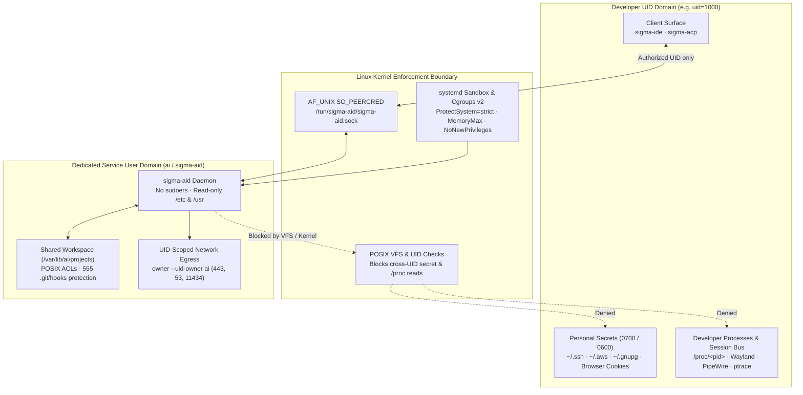

# Security Re-Evaluation: Operating `sigma-aid` Under a Dedicated System User

When `sigma-aid` runs under a dedicated, unprivileged service account (such as `sigma-aid` / `ai`, with a UID separate from the operating developer's UID), the host security posture shifts from **high risk** to **managed, defense-in-depth risk**.

This evaluation details what POSIX user separation eliminates at the Linux kernel boundary, what residual lateral risks remain across shared workspaces and local networks, and how to harden the service using `systemd` cgroup and namespace directives, POSIX ACLs, and UID-scoped firewall rules.



## 1. Revised Risk Matrix (Dedicated User vs. Same User)

Running an autonomous coding daemon under your own interactive login account grants every tool call and subprocess the exact same authority as your terminal. Separating the daemon into a dedicated service account changes the threat profile across all six primary attack vectors:

| Threat Vector | Same User (Developer UID) | Dedicated System User (`ai`) | Primary Residual Vulnerability |
|---|---|---|---|
| **Access to Personal Secrets** (`~/.ssh`, `~/.aws`, browser cookies) | **Critical** (Direct read) | **Negligible** (POSIX permissions block access) | World-readable files if developer `umask` is loose (`0755` vs `0700`). |
| **Process Inspection / Keylogging** (`ptrace`, `/proc`, IPC) | **High** (Can inspect or kill developer processes) | **None** (Blocked by Linux kernel UID check) | None. Cross-user `ptrace` is prohibited. |
| **Workspace / Build Poisoning** (Lateral escalation) | **N/A** (Already same user) | **Medium-High** | Altering build files (`CMakeLists.txt`) or source that the developer compiles and runs. |
| **Localhost & LAN Pivoting** | **High** | **Medium** | Unrestricted access to local or LAN network services (Ollama, Redis, metadata services). |
| **Host Resource Exhaustion** (Fork-bomb, OOM) | **High** | **Low-Medium** | Needs `systemd` cgroup resource limits to prevent starvation. |
| **Host System Mutation** (`/etc`, `/bin`, `sudo`) | **High** (Developer may have passwordless `sudo`) | **Negligible** (No `sudo`, `/etc` write-blocked) | Kernel privilege escalation (rare, requires unpatched kernel). |

## 2. Security Guarantees Established by User Separation

Running `sigma-aid` under a dedicated service account establishes three immediate Linux kernel protections without requiring container runtime overhead:

### Total Isolation of Developer Identity & Private Keys

- **Cryptographic Keys & Cloud Tokens:** The service user cannot read `/home/<developer>/.ssh/id_*`, `~/.gnupg`, `~/.aws/credentials`, `~/.config/gh/hosts.yml`, or browser SQLite databases (session cookies and web tokens). Standard Linux file modes (`0700` / `0600`) enforce this directly at the VFS layer.
- **Process Space Separation:** The `ai` user cannot inspect (`/proc/<pid>/mem`, `/proc/<pid>/environ`), debug (`ptrace`), or send signals (`SIGTERM`, `SIGKILL`) to developer processes.
- **User Session Sockets:** Access to developer user-session buses (`/run/user/<dev-uid>/bus`, Wayland display sockets, and PulseAudio/PipeWire audio streams) is denied by directory permissions on `/run/user/<dev-uid>`.

### Daemon IPC Authenticity (`SO_PEERCRED`)

- `sigma-aid` validates every client connection over `/run/sigma-aid/sigma-aid.sock` using Linux kernel peer credentials (`SO_PEERCRED`).
- The daemon only accepts connections from configured authorized developer UIDs (`main.allow_uids` / `main.admin_uids`) or `root`. Arbitrary local accounts or compromised guest users cannot connect to or command the daemon socket.

### Zero Administrative Privilege

- The dedicated service account has no entry in `/etc/sudoers` or `/etc/sudoers.d/`.
- System configuration files (`/etc`), system binaries (`/usr/bin`, `/bin`), and kernel parameters (`/sys`, `/proc/sys`) remain strictly read-only to the daemon and all child processes it spawns.

## 3. Residual Risks and the Lateral Escalation Path

While user separation isolates personal identity and administrative access, **one primary lateral escalation path and two operational risks remain** when collaborating on a shared machine:

### The Lateral Escalation Trap: Workspace Poisoning

Because the developer and `sigma-aid` collaborate on the same repository files (via shared group membership or POSIX ACLs), an indirect prompt injection or rogue tool invocation could tamper with shared executable build configurations:

- **The Scenario:** An agent reads untrusted external input, is manipulated by an injection payload, and modifies `CMakeLists.txt`, `Makefile`, `package.json`, or a test harness script inside the shared project tree.
- **The Escalation:** The next time the human developer runs `cmake --build` or executes tests directly under their personal login account, the modified build script runs with the **developer's full permissions**.
- **Protective Measures:**
  - Restrict write permissions on `.git/hooks/` (`chmod 555`) so the daemon cannot install automated Git execution hooks.
  - Inspect working-tree diffs in `sigma-ide` before running builds directly under your personal account outside the daemon's sandbox.

### Network Egress and Localhost Pivoting

By default on Linux, any local user account can open outbound TCP and UDP sockets:

- **Loopback Services:** The `ai` user can connect to unauthenticated services bound to `127.0.0.1` (such as local Docker TCP sockets, Redis, PostgreSQL, unauthenticated Ollama instances, or local web staging servers).
- **LAN Access:** The `ai` user can send packets across the local subnet to office machines, internal staging hosts, or router portals.
- **Exfiltration Risk:** Under a prompt-injection scenario, an unrestricted `exec` call could invoke `curl` to transmit repository snippets to an external endpoint unless outbound traffic is filtered by UID.

### Resource Exhaustion (Denial of Service)

If an agent executes code containing an infinite loop or a fork-bomb via `exec` or `evaluate_code`, it can saturate host CPU cores or exhaust physical memory:

- When running as a bare user without `systemd` cgroup v2 limits, a runaway build or subprocess tree can trigger the kernel OOM killer or starve interactive desktop sessions.

## 4. Hardening Recommendations for Dedicated-User Operation

To achieve near-container isolation while preserving the file I/O performance of a native Linux service account, apply the following three hardening layers:

### Systemd Service Hardening (`/etc/systemd/system/sigma-aid.service`)

Apply standard `systemd` namespace, filesystem, capability, and cgroup v2 directives to the service unit:

```ini
[Unit]
Description=Sigma AI Background Daemon
After=network.target

[Service]
Type=simple
User=ai
Group=ai
ExecStart=/usr/bin/sigma-aid --config /etc/sigma-aid/config.conf

# 1. Filesystem Protections
ProtectSystem=strict
ProtectHome=read-only
ReadWritePaths=/run/sigma-aid /var/lib/sigma-aid /var/lib/ai/projects
PrivateTmp=true
ProtectKernelTunables=true
ProtectKernelModules=true
ProtectControlGroups=true

# 2. Privilege Restriction
NoNewPrivileges=true
CapabilityBoundingSet=

# 3. Resource Bounds (Cgroups v2)
MemoryMax=8G
CPUQuota=400%
TasksMax=256

# 4. Process Isolation
RestrictAddressFamilies=AF_UNIX AF_INET AF_INET6
RestrictRealtime=true
LockPersonality=true
```

### Shared File Permissions (POSIX ACLs & Hook Locking)

Never use world-writable permissions (`chmod 777`). Use POSIX Access Control Lists (`setfacl`) to scope repository access strictly to the developer and the daemon service account, and lock `.git/hooks/`:

```bash
# Grant 'ai' read/write access only to designated project workspaces
setfacl -R -m u:ai:rwx /home/developer/projects
setfacl -R -d -m u:ai:rwx /home/developer/projects

# Ensure .git/hooks cannot be modified by the daemon
chmod -R 555 /home/developer/projects/*/.git/hooks/
```

### UID-Scoped Network Egress Restrictions

When `sigma-aid` only needs to reach local Ollama and HTTPS model providers, restrict outbound sockets owned by the `ai` UID using `iptables` (or `nftables` `meta skuid`):

```bash
# Restrict user 'ai' to DNS (53), HTTPS (443), and local Ollama (11434)
iptables -A OUTPUT -m owner --uid-owner ai -p tcp --dport 443 -j ACCEPT
iptables -A OUTPUT -m owner --uid-owner ai -p tcp --dport 11434 -j ACCEPT
iptables -A OUTPUT -m owner --uid-owner ai -p udp --dport 53 -j ACCEPT
iptables -A OUTPUT -m owner --uid-owner ai -d 127.0.0.1 -j ACCEPT
iptables -A OUTPUT -m owner --uid-owner ai -j REJECT
```

## 5. Summary Posture Comparison

| Configuration | Risk Verdict | Operational Recommendation |
|---|---|---|
| **Same User (Developer UID)** | `✘ High Risk` | Do not operate in this mode for untrusted repositories or external content. |
| **Dedicated User (Unconstrained)** | `✔ Moderate / Acceptable` | Protects personal SSH/cloud credentials and developer processes; workspaces remain exposed to build-script poisoning. |
| **Dedicated User + `systemd` Hardening & ACLs** | `✔ High Safety / Production Ready` | Recommended production standard. Delivers defense-in-depth isolation with native Linux filesystem performance. |
