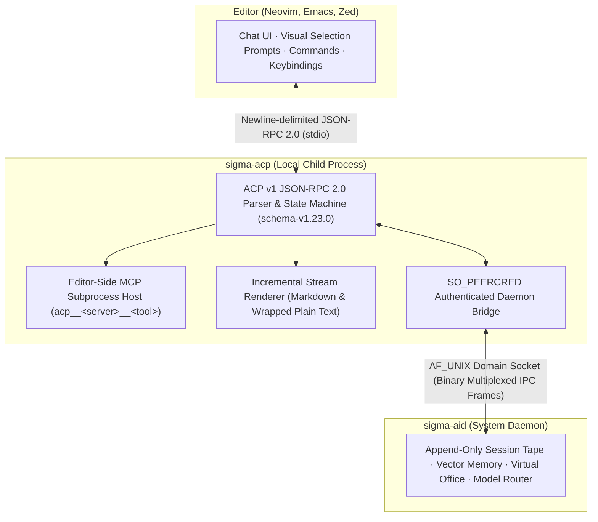

# sigma-acp (Agent Client Protocol Adapter)

`sigma-acp` is the **Agent Client Protocol (ACP)** adapter for the Sigma AI ecosystem. Written in C++23, it runs as a lightweight, `stdio`-based JSON-RPC 2.0 bridge that connects third-party text editors and IDEs (such as Neovim, Emacs, or Zed) to the local `sigma-aid` daemon.

Any editor supporting the open Agent Client Protocol specification can spawn `sigma-acp` to drive conversational AI, stream generated tokens, inspect workspace files, switch AI models dynamically mid-session, and host editor-side Model Context Protocol (MCP) tools.



## System Architecture and CLI Invocation

The editor spawns `sigma-acp` as a local child process. Communication between the editor and adapter runs over standard input and output (`stdin`/`stdout`) using newline-delimited JSON-RPC 2.0, while the adapter talks to `sigma-aid` over the local `AF_UNIX` domain socket using Sigma's multiplexed binary IPC frames.

### Process topology and transport boundary

Unlike monolithic editor plugins that embed HTTP clients and API keys inside the editor process, `sigma-acp` keeps all provider credentials, conversation state, tool execution policies, and long-term memory inside `sigma-aid`. The adapter translates ACP v1 JSON-RPC requests into binary daemon frames and streams token and tool updates back to the editor buffer.

### Command-line interface

When launched by an editor plugin, `sigma-acp` accepts the following flags:

```bash
sigma-acp [--socket <path>] [--agent <name>] [--service-user <user>] \
          [--text-rendering <mode>] [--render-width <cols>]
```

| Flag | Default | Purpose |
| --- | --- | --- |
| `--socket <path>` | `/run/sigma-aid/sigma-aid.sock` (or `$SIGMA_ACP_SOCKET`) | Path to the local `sigma-aid` `AF_UNIX` domain socket. |
| `--agent <name>` | Daemon default route | Default Virtual Office staff member, position, or model route override. |
| `--service-user <user>` | `ai` | Expected Linux service account running the packaged daemon for `SO_PEERCRED` verification. |
| `--text-rendering <mode>` | `markdown` | Output formatting mode: `markdown` (raw pass-through) or `plain` (column-wrapped plain text). |
| `--render-width <cols>` | `80` (range `20`–`1000`) | Target column width when rendering in `plain` mode. |

### Official Neovim and Emacs integrations

`sigma-ai` ships complete, production-ready ACP client packages in `contrib/acp/`:

- **Neovim (`contrib/acp/neovim/`):** Lua plugin built on non-blocking `vim.loop` standard I/O. Provides `:SigmaChat` (split sidebar interface), `:SigmaAsk`, visual selection prompts (`:'<,'>SigmaSelection`), a tab-completed model picker (`:SigmaModel`), and a headless test runner (`:SigmaTest`).
- **Emacs (`contrib/acp/emacs/`):** Native Elisp package (`sigma-acp.el`) bound under the `C-c a` prefix: chat toggle (`C-c a c`), quick ask (`C-c a a`), active region explain (`C-c a r`), runtime model switch (`C-c a m`), and in-flight cancellation (`C-c a k`).

## Specification Compliance and Protocol Lifecycle

`sigma-acp` implements **Agent Client Protocol (ACP) version 1**, pinned against `schema-v1.23.0` from the open standard.

### 1. Negotiation (`initialize`)

Editors initiate the session with an `initialize` request. `sigma-acp` enforces strict initialization gating: any method sent prior to `initialize` is rejected immediately with standard JSON-RPC error code `-32002` (`server_not_initialized`).

```json
{
  "protocolVersion": 1,
  "agentInfo": { "name": "sigma-acp", "version": "1.0.0" },
  "agentCapabilities": {
    "loadSession": false,
    "promptCapabilities": {
      "image": false,
      "audio": false,
      "embeddedContext": false
    },
    "mcpCapabilities": { "http": false, "sse": false }
  }
}
```

### 2. Session creation and dynamic model switching (`session/new` & `session/set_config_option`)

- **`session/new`:** Accepts the active working directory (`cwd`) and an optional array of editor-defined `mcpServers`. `sigma-acp` queries `sigma-aid` for active provider routes and returns the assigned `sessionId` together with `configOptions` enumerating all configured models (such as Claude, GPT, Gemini, or local Ollama routes).
- **`session/set_config_option`:** Switches the active model route at runtime mid-session—for example, moving from a fast local coding model to a frontier reasoning model—without losing conversation history or session state.

### 3. Streaming prompts and asynchronous cancellation (`session/prompt` & `session/cancel`)

- **`session/prompt`:** Accepts non-empty content blocks (`text` blocks and `resource_link` blocks referencing workspace files). `sigma-acp` dispatches the turn to `sigma-aid`, streams incremental chunks back via `session/update` notifications (`agent_message_chunk`), and concludes with `stopReason: "end_turn"` plus token telemetry in `_meta.usage` (`inputTokens`, `outputTokens`).
- **`session/cancel`:** The editor can abort an in-flight turn at any moment by sending a `session/cancel` notification. `sigma-acp` forwards the cancellation signal directly to the daemon rally root via the wire correlation ID, stopping active tool calls and token generation immediately.

## Editor-Side MCP Hosting and Dual Text Rendering

`sigma-acp` bridges editor-local tools into the daemon's tool router and adapts streamed responses for both graphical and terminal buffers.

### Subprocess management and `acp__*` namespace isolation

When an editor passes `stdio`-based MCP server definitions in `mcpServers` during `session/new`, `sigma-acp` (`mcp_host_t`) spawns and supervises those child processes directly beneath the active workspace `cwd`. Tools exposed by each editor-hosted server are registered with `sigma-aid` under the isolated `acp__<server>__<tool>` namespace.

### Daemon-to-editor execution relay

When the model invokes an `acp__*` tool during a turn, `sigma-aid` sends a tool execution frame (`kind: 't'`, `op: 'x'`) across the `AF_UNIX` socket to `sigma-acp`. The adapter executes the tool inside the local MCP child process and returns the result payload (`kind: 't'`, `op: '='`) to the daemon so the turn continues seamlessly.

### Dual text-rendering engine (`markdown_renderer.hpp`)

Because terminal editors often display responses inside plain buffers without a full Markdown engine, `sigma-acp` includes an incremental stream renderer negotiated during `initialize` via `clientCapabilities._meta.sigma.textRendering`:

```json
{
  "_meta": {
    "sigma": {
      "textRendering": { "mode": "plain", "width": 72 }
    }
  }
}
```

- **`markdown` mode:** Streams raw Markdown through unchanged for editors with built-in Markdown or Tree-sitter previewers.
- **`plain` mode:** Wraps text to the configured column width, underlines ATX headings (`===` and `---`), formats inline links as `title <url>`, renders lists with clean bullets (`•`, `◦`, `▪`) and checkboxes (`☐`, `☑`), preserves indented code fences, and buffers Markdown tables to compute column widths—automatically falling back to a `Key: Value` card layout when a table is wider than the terminal column limit.

## Security, Bounds, and Compliance Controls

`sigma-acp` enforces explicit security and resource boundaries at both the editor `stdio` boundary and the daemon `AF_UNIX` socket boundary:

| Boundary Area | Enforced Safeguard |
| --- | --- |
| **Socket Peer Authentication** | Before transmitting any frame over the `AF_UNIX` socket, `sigma-acp` verifies kernel peer credentials (`SO_PEERCRED`). The listening daemon UID must match either the caller's UID or `--service-user` (`ai`); sockets owned by other users are rejected. |
| **Path Confinement** | `resource_link` file URIs (`file:///...`) are percent-decoded, canonicalized, and verified to reside beneath the session `cwd`. Directory traversals (`../`) and out-of-tree paths are refused. |
| **MCP Subprocess Hardening** | MCP server executables must be absolute paths. Arguments are capped at `64`, environment variables at `64`, and individual field lengths at `4,096` bytes. Any string containing an embedded `NUL` (`\0`) byte is rejected to prevent `execve` truncation attacks. |
| **Input & Memory Quotas** | Request line length is capped at `8 MiB`, conversation history at `128` messages (`4 MiB` total), prompt blocks at `1,024`, concurrent prompt worker threads at `16`, and active sessions at `64`. |
| **Broadcast Flood Protection** | While awaiting a daemon response, unsolicited broadcasts or mismatched correlation IDs are bounded to at most `64` skipped frames (`1 MiB`) so a noisy broadcast stream cannot exhaust adapter memory. |
