# sigma-wsd

`sigma-wsd` (Workspace Daemon) is a minimal, high-performance remote workspace agent written in C++23. It ships with the `sigma-aid` Linux system package (`/usr/bin/sigma-wsd`) and runs on a remote Linux development host so the local desktop IDE (`sigma-ide`) can browse, read, atomically write, and watch remote workspaces over a single SSH connection—without opening TCP ports or installing a runtime bundle into the user's home directory.

```mermaid
sequenceDiagram
    autonumber
    actor User as Local Developer
    participant IDE as sigma-ide (Local Desktop)
    participant SSH as ssh client
    participant WSD as sigma-wsd (Remote Linux Host)
    participant FS as Remote Filesystem

    User->>IDE: Open Remote Project (ssh://gauss/work)
    IDE->>SSH: Run: ssh gauss sigma-wsd --stdio --root /work
    SSH->>WSD: Spawns process connected via stdin/stdout

    rect rgb(17, 36, 48)
    note over IDE,WSD: Handshake (Channel 0)
    IDE->>WSD: Frame(Ch=0): hello {version: 1, root: "/work"}
    WSD-->>IDE: Frame(Ch=0): hello {agent: "sigma-wsd", caps: {...}, credits: 64}
    end

    rect rgb(18, 42, 34)
    note over IDE,WSD: Directory Browsing & File Loading (Channel 1)
    IDE->>WSD: Frame(Ch=1): op: "list", path: "."
    WSD->>FS: openat2 / getdents64
    FS-->>WSD: Directory entries
    WSD-->>IDE: Frame(Ch=1): entries: [...]

    IDE->>WSD: Frame(Ch=1): op: "read", path: "src/main.cpp"
    WSD->>FS: openat2 / read
    WSD-->>IDE: Frame(Ch=1, BINARY): Content payload + EOF
    end

    rect rgb(44, 34, 20)
    note over IDE,WSD: Real-time Watching (Channel 2)
    IDE->>WSD: Frame(Ch=2): op: "watch", path: ".", recursive: true
    WSD->>FS: inotify_add_watch()
    FS-->>WSD: inotify event (build modifies binary)
    WSD-->>IDE: Frame(Ch=2): op: "change", kind: "modify", path: "build/app"
    end

    rect rgb(42, 22, 28)
    note over IDE,WSD: Teardown
    IDE->>WSD: Frame(Ch=0): op: "bye"
    WSD-->>IDE: Frame(Ch=0): op: "bye"
    WSD->>WSD: Process exits (rc: 0)
    end
```



## Deployment and invocation model

Unlike remote editor architectures that download a Node.js server bundle into `~/.vscode-server` over SSH or `curl`, `sigma-wsd` is pre-installed on the target host as a native binary inside the `sigma-aid` `.deb` package (`/usr/bin/sigma-wsd`) and links statically against `libstdc++` and `libgcc` (`-static-libstdc++ -static-libgcc`).

### Pure stdio transport (zero open ports)

`sigma-wsd` never opens a TCP listening port, network socket, or background root daemon on the remote server. When you open a remote workspace in `sigma-ide`, the local desktop client connects over standard SSH and spawns `sigma-wsd` directly:

```bash
ssh <host> sigma-wsd --stdio --root <workspace-dir>
```

All traffic runs through that single SSH session's encrypted `stdin` and `stdout` pipes. When the SSH session closes or the client sends a `bye` control message, `sigma-wsd` flushes open descriptors and exits immediately.

### User identity and kernel path confinement

The `sigma-wsd` process runs as the authenticated SSH user—not `root` and not a shared service account—so remote file ownership and permissions match your Linux account on the host. Every filesystem operation is confined beneath `--root` using Linux descriptor-relative syscalls (`openat2` with `RESOLVE_BENEATH` and `O_NOFOLLOW`), preventing directory traversal and symlink escapes outside the workspace root.

### Resource footprint and startup

Because `sigma-wsd` is a self-contained native C++23 binary with no scripting runtime or external library dependencies beyond `glibc`, it starts in under 5 milliseconds and uses approximately **2.5 MB to 3 MB** of resident memory (RSS) per active remote workspace connection.

## Wire protocol and channel multiplexing

All traffic across the SSH `stdin`/`stdout` pipe is organized into 8-byte binary frame headers followed by `N` payload bytes. Windowed, credit-based flow control per channel prevents client or server buffer bloat during bulk file transfers or large directory walks:

```text
+----------------+----------------+--------------------+----------------------+
| Channel ID     | Flags          | Payload Length     | Payload Bytes        |
| (uint16_t, LE) | (uint16_t, LE) | (uint32_t, LE)     | (N bytes)            |
+----------------+----------------+--------------------+----------------------+
|<-- 2 bytes --->|<-- 2 bytes --->|<---- 4 bytes ----->|<----- N bytes ------>|
```

| Header field | Values | Purpose |
|---|---|---|
| `channel_id` (`uint16_t`, LE) | `0` (`Control`), `1` (`Files`), `2` (`Watch`) | Multiplexes session control, file I/O, and real-time `inotify` events over one stream without head-of-line blocking. |
| `flags` (`uint16_t`, LE) | `0x0001` (`CREDIT`), `0x0002` (`CLOSE`), `0x0004` (`BINARY`) | `CREDIT` carries flow credits in the first 4 payload bytes; `CLOSE` half-closes the channel; `BINARY` marks raw file byte chunks. |
| `payload_length` (`uint32_t`, LE) | `0 .. max_frame_bytes` | Exact byte length of the payload immediately following the 8-byte header. |

## Multiplexed communication channels

### Channel 0: Control (`handshake`, `ping`, `bye`)

Channel `0` manages session initialization, capability negotiation, flow-control credit grants, heartbeats, and clean teardown using JSON payloads:

1. **Handshake (`op: "hello"`):** The client sends the protocol version, requested workspace root, and desired capabilities. `sigma-wsd` validates and canonicalizes the root path and replies with its supported capabilities and initial frame window (`64` credits):
   ```json
   {
     "op": "hello",
     "agent": "sigma-wsd",
     "version": 1,
     "root": "/home/user/project",
     "caps": {
       "files": true,
       "watch": true,
       "chunked_write": true,
       "if_match": true,
       "follow_symlinks": true
     },
     "initial_credits": 64
   }
   ```
2. **Heartbeat (`op: "ping"` / `op: "pong"`):** Measures round-trip latency and detects dropped SSH transports.
3. **Shutdown (`op: "bye"` / `flags: CLOSE`):** Flushes open file handles, detaches `inotify` watch descriptors, replies with `op: "bye"`, and exits with return code `0`.

### Channel 1: Files (`stat`, `list`, `read`, `write`, `rename`, `delete`, `mkdir`)

Channel `1` executes all workspace filesystem operations beneath the confined `--root` descriptor:

- **`stat` & `list`:** Reads entry metadata (size, permissions, entry kind, modification timestamp, and content/mtime `etag`) and returns sorted, filtered directory listings.
- **`read`:** Sends the file metadata frame followed by raw `BINARY` (`0x0004`) payload chunks, terminating with `eof: true` on the final frame.
- **`write` (atomic with optimistic concurrency):** Supports single-frame or chunked writes using `openat2`, temporary staging, and atomic replacement via `SYS_renameat2` (`RENAME_NOREPLACE` / atomic swap). Clients pass `if_match` with the last observed `etag` so concurrent modifications by a compiler, git command, or agent tool on the remote host are never silently overwritten.
- **`mkdir`, `rename`, and `delete`:** Performs directory creation, atomic renames, and file removal within the workspace boundary.

### Channel 2: Watch (recursive `inotify` streaming)

Channel `2` streams real-time filesystem notifications powered by Linux `inotify` (`<sys/inotify.h>`):

1. **Subscribe:** The client requests a watch on a relative path:
   ```json
   { "op": "watch", "path": "src", "recursive": true }
   ```
2. **Bidirectional descriptor tracking:** `sigma-wsd` registers `inotify` descriptors across the directory tree and maintains a bidirectional map between watch descriptors (`wd`) and relative workspace paths, automatically attaching or pruning watches when subdirectories are created, renamed, or deleted.
3. **Live change events:** When a build, test run, or git checkout modifies the tree, `sigma-wsd` streams structured change notifications back to `sigma-ide`:
   ```json
   {
     "op": "change",
     "kind": "modify",
     "path": "src/main.cpp",
     "etag": "1710000000-12345"
   }
   ```

## Platform architecture and comparison

`sigma-wsd` is built specifically for Linux targets (`if(NOT APPLE)` in CMake) because its safety and performance guarantees rely directly on Linux kernel primitives: `openat2` with `RESOLVE_BENEATH`, `SYS_renameat2`, `<sys/inotify.h>`, and `<sys/eventfd.h>`.

| Capability | `sigma-wsd` (`/usr/bin/sigma-wsd`) | SSHFS / NFS Mounts | Remote Node.js Editor Servers |
|---|---|---|---|
| **Deployment** | Pre-installed native binary in `sigma-aid` `.deb` (~2–4 MB, static `libstdc++`). | Requires FUSE/kernel mount setup and client privileges. | Downloads 200+ MB Node.js runtime and scripts into `~/.vscode-server`. |
| **Network surface** | Zero listening ports; pure `stdio` over one SSH connection. | Network filesystem mount state; stalls on packet loss. | Spawns background server processes and local forwarded sockets. |
| **Directory & tree walks** | Executed locally in the remote Linux kernel via `openat2` / `getdents64`. | Compounds round-trip latency on every `stat` and directory traversal. | Runs inside a remote Node.js process with heavy heap overhead. |
| **Write safety** | Atomic `SYS_renameat2` + `etag` / `if_match` conflict detection + `RESOLVE_BENEATH`. | Partial writes on disconnect; no path-resolution confinement. | Workspace-level file writes without kernel `RESOLVE_BENEATH` confinement. |
| **Memory per session** | ~2.5 MB – 3 MB RSS, <5 ms startup. | Kernel/FUSE cache overhead. | Hundreds of megabytes of resident Node.js heap per window. |
