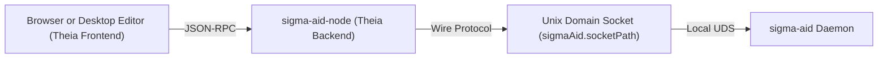

# Sigma IDE (`sigma-ide`)

`sigma-ide` (application name **Sigma AI**) is a standalone Integrated Development Environment (IDE) built on published Eclipse Theia `1.72.3` packages. It serves as the graphical editor front end for the `sigma-aid` background daemon.

`sigma-ide` does not call language model providers directly from the editor. Instead, its Node.js backend connects to a running `sigma-aid` daemon over a Unix domain socket (UDS). The daemon manages provider credentials, model routing, agent delegation, persistent sessions, and workspace tool authority.

## Architecture

You can run `sigma-ide` either as a browser application (`@sigma-ai/browser-app` in `applications/browser`) or as a single-user Electron desktop application (`@sigma-ai/electron-app` in `applications/electron`). Both deployments present the same workbench and connect to `sigma-aid` through the same backend bridge.

1. The browser window or Electron renderer runs the Eclipse Theia frontend workbench, Monaco code editor, and Sigma React widgets.
2. The frontend communicates with the `@sigma-ai/sigma-aid-node` backend module over Theia JSON-RPC services.
3. The `@sigma-ai/sigma-aid-node` backend connects over a local Unix domain socket to the `sigma-aid` daemon.

## Extension packages

`sigma-ide` adds six extension packages in `packages/` on top of the Eclipse Theia `1.72.3` workbench:

| Package | Role |
|---|---|
| `@sigma-ai/sigma-aid-core` | Shared protocol definitions, connection state types, configuration sanitizers, and the `sigmaAid.*` preference schema. |
| `@sigma-ai/sigma-aid-node` | Node.js backend Unix domain socket client, session manager, Git service, static asset server, and Theia `LanguageModelProvider` for `sigma-aid`. |
| `@sigma-ai/sigma-aid-theia` | Frontend IDE integration, `View > Sigma AI` commands, status bar indicator, Setup Wizard, AI Configuration view, Markdown and diagram preview, curated themes, and VS Code keybindings. |
| `@sigma-ai/sigma-aid-tools` | Frontend IDE tool bridge that defines `theia.*` namespace tool descriptors and handlers for workspace, editor, diagnostics, symbol, status bar, and command operations. |
| `@sigma-ai/sigma-aid-console` | Multi-instance bottom-panel **Sigma Console** widget with streaming Markdown, `highlight.js` code highlighting, `KaTeX` math, inline diagrams, slash commands, `@agent` mentions, and voice dictation. |
| `@sigma-ai/sigma-aid-chat` | **Sigma Fleet**, **Sigma Sessions**, Source Control **Working Tree**, **Worktrees**, and interactive **Commit Graph** widgets. |

## Documentation in this section

| [Install and run](/sigma-ide/install-and-run/) | Debian package installation, daemon socket discovery, and launching the workbench. |
| [Features](/sigma-ide/features/) | Console, sessions, fleet, AI configuration, source control widgets, commands, status bar items, and IDE tools. |
| [Settings](/sigma-ide/settings/) | Reference for all `sigmaAid.*` preferences and default workbench settings. |
| [Remote and browser deployment](/sigma-ide/remote-and-browser/) | Running `sigma-ide` as a browser front end behind a Unix domain socket and reverse proxy. |
