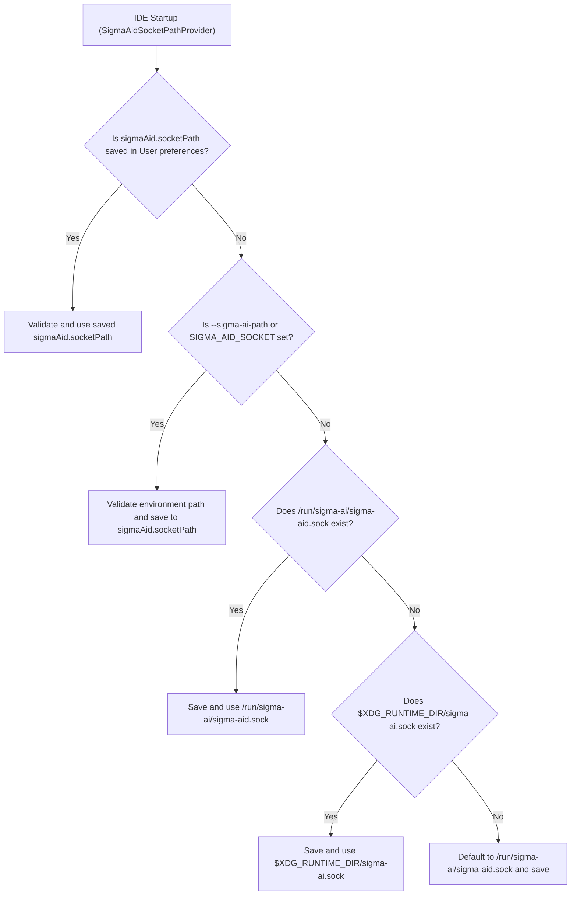

# Install and run `sigma-ide`

`sigma-ide` requires a running `sigma-aid` daemon on the same host. The IDE connects to the daemon over a local Unix domain socket.

## Prerequisites

- **Node.js `>=20`** (required when building or running from the source tree or tarball).
- **A running `sigma-aid` daemon** listening on a local Unix domain socket. When installed from the Debian package, you can start the daemon with `sudo systemctl start sigma-aid` and check its status with `systemctl status sigma-aid`.

## Build and start from source

Run the following commands from the `sigma-ide` directory:

1. Skip optional test-browser downloads when installing dependencies in a headless or sandbox environment:
   ```bash
   export PUPPETEER_SKIP_DOWNLOAD=true
   export PLAYWRIGHT_SKIP_BROWSER_DOWNLOAD=1
   ```
2. Install the workspace dependencies:
   ```bash
   npm install
   ```
3. Compile all TypeScript packages and the application:
   ```bash
   npm run compile
   ```
4. Download the bundled color theme plugins into `plugins/bundled` (optional):
   ```bash
   npm run download:plugins
   ```
5. Build the development frontend and backend bundle:
   ```bash
   npm run build
   ```
   For a minified production bundle without source maps, run `npm run build:production`.
6. Start the IDE:
   ```bash
   npm start
   ```

## Startup commands and launchers

The root `package.json` and `applications/browser/package.json` provide several startup scripts depending on how you deploy the editor:

| Command | Launcher | Behavior |
|---|---|---|
| `npm start` | `sigma-ide` (`applications/browser/bin/sigma-ide.js`) | Starts the browser application. The README notes `http://localhost:3000` for local browser use; the `sigma-ide` launcher binds its inbound HTTP listener to a Unix domain socket (`/tmp/sigma-$USER-ide.sock` by default, or the path passed to `--socket-path`). |
| `npm run start:sigma` | `sigma-code-server` (`applications/browser/bin/sigma-code-server.js`) | Launches the generated backend directly through the `sigma-code-server` wrapper with bundled plugins and Open VSX router configuration. |
| `npm run start:raw` | `theia start` | Starts the stock Theia HTTP server directly with bundled plugins and Open VSX router configuration. |
| `npm run start:electron` | `electron` (`applications/electron/scripts/sigma-electron-main.js`) | Starts the single-user Electron desktop application after `npm run build:electron`. |

You can also package standalone Linux desktop installers from the Electron target with `npm run package:electron:deb` (Debian `.deb` package) or `npm run package:electron:appimage` (`AppImage`).

## Configuring the `sigma-aid` daemon socket

`sigma-ide` stores the target daemon socket path in the user-scope preference **`sigmaAid.socketPath`** (defined in `packages/sigma-aid-core/src/common/sigma-aid-preferences.ts`).

### How the socket path is resolved



1. **Saved user preference (`sigmaAid.socketPath`):** On startup, `SigmaAidSocketPathProvider` inspects `sigmaAid.socketPath` at `User` scope (stored in `~/.sigma-ide/settings.json`, or `$THEIA_CONFIG_DIR/settings.json`). If a path is already stored, that choice takes precedence over environment variables on every subsequent start.
2. **Command-line flag or environment seed:** If `sigmaAid.socketPath` has not been set yet, you can supply the initial socket path with `--sigma-ai-path <path>` or the `SIGMA_AID_SOCKET` environment variable:
   ```bash
   sigma-ide --sigma-ai-path /tmp/sigma-ai-custom.sock --socket-path /tmp/my.sock
   ```
3. **Automatic discovery and default:** When neither a saved preference nor `SIGMA_AID_SOCKET` is present on first run, the backend checks whether the system daemon socket `/run/sigma-ai/sigma-aid.sock` exists, then checks `$XDG_RUNTIME_DIR/sigma-ai.sock` for a per-user systemd service, and otherwise falls back to `/run/sigma-ai/sigma-aid.sock`. The resolved path is then saved to `sigmaAid.socketPath`.

### Socket security validation

Every socket path—whether seeded from the environment or entered in the UI—must pass backend validation before `sigma-ide` connects:

- The path must be absolute, normalized, and contain no symbolic links in its path components (except `/var/run`).
- The canonical path must reside under one of the allow-listed root directories: `/tmp`, `/run`, or `/var/run`.
- If the socket is under `/tmp` and already exists, it must be owned by the current user (`UID`) or `root` (`UID 0`).

### Changing the socket path in the IDE

Because `sigmaAid.socketPath` is marked `hidden: true` and scoped to `User` only, workspace files cannot redirect the IDE to another daemon socket, and the setting does not appear in the generic Theia Settings tree. To point the IDE at a different `sigma-aid` socket after first run:

1. Open **Sigma AI: Open AI Configuration** from `View > Sigma AI` or from the Activity Bar settings menu.
2. Edit the **Sigma Aid socket path** field in the top status bar of the **AI Configuration** view.
3. Press `Enter` (or click **Apply**). The backend validates the new path, saves it to `sigmaAid.socketPath`, and reconnects.

## First-time Setup Wizard

When `sigmaAid.enroller.completed` is `false` (the default on a fresh profile), `sigma-ide` automatically opens the **Sigma AI Setup Wizard** on startup. You can also open it at any time with the **Sigma AI: Open Setup Wizard** command or by launching the binary with `--enroll` (or `SIGMA_AID_ENROLL=true`).

The wizard guides you through four steps:

1. **Daemon Connection:** Verifies that `sigma-ide` is connected to `sigma-aid` at the configured Unix domain socket.
2. **Subscriptions:** Configures API keys or OAuth authorization for at least one enabled chat connection.
3. **Capabilities:** Reviews optional system connections for `memory` (embeddings and recall), `speech-to-text` (voice dictation), and `dataforseo` (web search).
4. **Activation:** Summarizes daemon, chat route, and system readiness (`Full`, `Degraded`, or `Blocked`) and marks onboarding complete once at least one chat route is ready.
