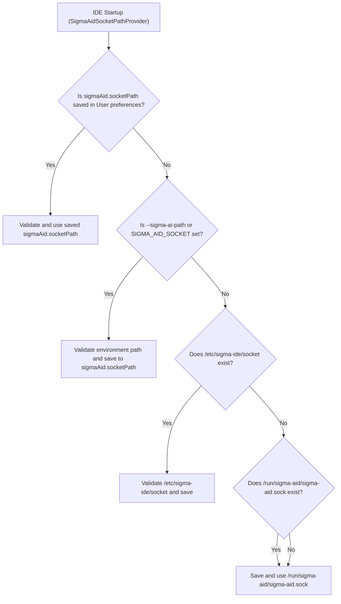

# Install and run `sigma-ide`

`sigma-ide` requires a running `sigma-aid` daemon on the same host. The IDE connects to the daemon over a local Unix domain socket (`/run/sigma-aid/sigma-aid.sock`) and never sends provider credentials or model traffic directly from the editor.

## 1. Install `sigma-aid` first

Before installing the IDE, install the `sigma-aid` Debian package (`sudo dpkg -i sigma-aid-v<version>.deb`) so `/etc/sigma-aid/config.conf` and `/run/sigma-aid/sigma-aid.sock` are present on the machine. See [Install and run `sigma-aid`](/sigma-aid/install/) for the daemon installation and browser Setup Wizard walkthrough.

## 2. Install the `sigma-ide` Debian package

Install the desktop `.deb` package with `dpkg -i`:

```bash
sudo dpkg -i sigma-ide-v<version>.deb
```

During package configuration (`postinst`), the installer:

1. Registers `/usr/bin/sigma-ide` via `update-alternatives` and installs the desktop launcher and MIME entries.
2. Installs and loads the bundled AppArmor profile (`/etc/apparmor.d/sigma-ide`) on systems with AppArmor `abi/4.0` support.
3. Reads `main.socket` from `/etc/sigma-aid/config.conf` and records the daemon socket path in `/etc/sigma-ide/socket` so `sigma-ide` connects to your local `sigma-aid` daemon automatically on first launch.

If you installed `sigma-ide` before installing `sigma-aid`, run `sudo dpkg-reconfigure sigma-ide` after installing the daemon to record `/etc/sigma-ide/socket`.

## 3. Launch `sigma-ide`

Start the workbench from your desktop application launcher (**Sigma AI**) or from a terminal:

```bash
sigma-ide
```

You can also open the embedded **Sigma AI Setup Wizard** at any time from the workbench command palette (**Sigma AI: Open Setup Wizard**) or by passing `--enroll` (`SIGMA_AID_ENROLL=true`) at launch.

## How the daemon socket path is resolved

`sigma-ide` stores the target daemon socket path in the user-scope preference **`sigmaAid.socketPath`**.



1. **Saved user preference (`sigmaAid.socketPath`):** On startup, `SigmaAidSocketPathProvider` inspects `sigmaAid.socketPath` at `User` scope (stored in `~/.sigma-ide/settings.json`). If a path is already stored, that choice takes precedence on subsequent starts.
2. **Command-line flag or environment seed:** If `sigmaAid.socketPath` has not been set yet, you can supply the initial socket path with `--sigma-ai-path <path>` or the `SIGMA_AID_SOCKET` environment variable.
3. **System drop-in and default discovery:** When no user preference or environment override is set, the backend reads `/etc/sigma-ide/socket` (written by the `.deb` installer from `/etc/sigma-aid/config.conf`), then checks `/run/sigma-aid/sigma-aid.sock`, and saves the resolved path to `sigmaAid.socketPath`.

### Socket security validation

Every socket path—whether recorded by the installer, seeded from the environment, or entered in the UI—must pass backend validation before `sigma-ide` connects:

- The path must be absolute, normalized, and contain no symbolic links in its path components (except `/var/run`).
- The canonical path must reside under one of the allow-listed root directories: `/tmp`, `/run`, or `/var/run`.
- If the socket is under `/tmp` and already exists, it must be owned by the current user (`UID`) or `root` (`UID 0`).

### Changing the socket path in the IDE

Because `sigmaAid.socketPath` is marked `hidden: true` and scoped to `User` only, repository workspace files cannot redirect the IDE to another daemon socket. To point the IDE at a different `sigma-aid` socket:

1. Open **Sigma AI: Open AI Configuration** from `View > Sigma AI` or from the Activity Bar settings menu.
2. Edit the **Sigma Aid socket path** field in the top status bar of the **AI Configuration** view.
3. Press `Enter` (or click **Apply**). The backend validates the new path, saves it to `sigmaAid.socketPath`, and reconnects.

## Remove or purge `sigma-ide`

- **Keep user settings (`sudo apt remove sigma-ide`):** Removes the application binary while leaving `/etc/sigma-ide/socket` and `~/.sigma-ide` intact so a later reinstall resumes with your existing settings and keymaps.
- **Complete wipe (`sudo apt purge sigma-ide`):** Removes the application directory, `/etc/sigma-ide/socket`, the AppArmor profile and cache, and per-user IDE state (`~/.sigma-ide`, `~/.config/sigma-ide`, and `~/.cache/sigma-ide`).
