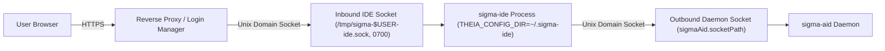

# Remote and browser deployment

`sigma-ide` is designed to run either as a local desktop editor connected to a remote Linux host via [`sigma-wsd`](/sigma-aid/sigma-wsd/) over SSH `stdio`, or as a browser-accessible editor server on a Linux host while connecting to a local or central `sigma-aid` daemon over a Unix domain socket. For multi-user licensing and how active users map to seats on a shared host, see [Team setup](/sigma/team-setup/).

## Two-socket architecture

When launched via `bin/sigma-ide` (or `applications/browser/bin/sigma-ide.js`), the browser server uses two separate Unix domain sockets instead of binding an unauthenticated TCP port:



1. **Inbound browser/proxy socket (`--socket-path`):** `applications/browser/bin/sigma-ide.js` intercepts the main Theia HTTP server `listen()` call, unlinks any stale socket file at the target path, binds the server to that Unix domain socket, and sets its permissions to `0700` (`rwx------`). By default, the path is `/tmp/sigma-$USER-ide.sock`.
2. **Outbound `sigma-aid` daemon socket (`--sigma-ai-path` / `SIGMA_AID_SOCKET`):** The backend connects to the `sigma-aid` daemon socket resolved by `SigmaAidSocketPathProvider` (seeded from `--sigma-ai-path`, `SIGMA_AID_SOCKET`, `/run/sigma-ai/sigma-aid.sock`, or `$XDG_RUNTIME_DIR/sigma-ai.sock`, and persisted in `sigmaAid.socketPath` at `User` scope).

## Launcher flags and environment variables

Both `--flag value` and `--flag=value` forms are supported by `applications/browser/bin/sigma-ide.js`:

| Flag or environment variable | Default | Purpose |
|---|---|---|
| `--socket-path <path>` | `/tmp/sigma-$USER-ide.sock` | Inbound Unix domain socket where the `sigma-ide` HTTP server listens for connections from a reverse proxy or login manager. Created with mode `0700`. |
| `--sigma-ai-path <path>` | *(none; falls back to `SIGMA_AID_SOCKET`)* | Sets `SIGMA_AID_SOCKET` in the backend process environment to seed the initial `sigma-aid` daemon socket path. |
| `SIGMA_AID_SOCKET` | `/run/sigma-ai/sigma-aid.sock` (fallback) | Environment variable used to seed `sigmaAid.socketPath` on first run when no user preference has been saved yet. Must resolve inside `/tmp`, `/run`, or `/var/run`. |
| `THEIA_CONFIG_DIR` | `~/.sigma-ide` | Per-user configuration directory holding `settings.json`, keymaps, and plugin state. Can be overridden per session by a login manager. |
| `THEIA_PLUGINS` | `local-dir:<root>/plugins/bundled` | Additional plugin directory (for example `local-dir:%h/.sigma-ide/plugins` in a systemd user unit) loaded alongside the central bundled plugins. |
| `--enroll` or `SIGMA_AID_ENROLL=true` | `false` | Forces the **Sigma AI Setup Wizard** to open on startup even if `sigmaAid.enroller.completed` is already `true`. |

The `sigma-ide` entry point also renames its own OS process title to `sigma-ide` and preloads `sigma-task-preload.js` via `NODE_OPTIONS` so forked Node.js child processes (plugin host, file watcher, IPC bootstrap) appear as `sigma-task` in `ps`, `top`, and `htop`.

## Running as a systemd user service

The repository includes an example systemd user unit at `docs/example-user-unit.service` for running a singleton `sigma-ide` instance per user:

```ini
[Unit]
Description=Singleton sigma-ide instance for SSH login
After=network.target

[Service]
Type=simple
ExecStart=/usr/local/lib/nodejs/node-v22.23.1-linux-x64/bin/node \
    /usr/local/lib/sigma/v2.0.0/applications/browser/bin/sigma-ide.js \
    --plugins=local-dir:/usr/local/lib/sigma/v2.0.0/plugins/bundled \
    --ovsx-router-config=/usr/local/lib/sigma/v2.0.0/applications/browser/ovsx-router-config.json \
    --socket-path=/tmp/sigma-%u-ide.sock
Environment=THEIA_PLUGINS=local-dir:%h/.sigma-ide/plugins
Environment=SIGMA_AID_SOCKET=/tmp/sigma-ai-test.sock
ExecStopPost=/bin/echo "SSH session ended"
Restart=on-failure

[Install]
WantedBy=default.target
```

To install and start the user service as documented in `docs/example-user-unit.service`:

1. Create your user systemd directory:
   ```bash
   mkdir -p ~/.config/systemd/user
   ```
2. Copy the unit file into `~/.config/systemd/user/` and set its permissions:
   ```bash
   cp docs/example-user-unit.service ~/.config/systemd/user/code-server-ssh.service
   chmod 644 ~/.config/systemd/user/code-server-ssh.service
   ```
3. If the service should remain running after you log out of SSH, enable systemd lingering for your account:
   ```bash
   loginctl enable-linger <username>
   ```
4. Reload the user systemd manager and enable the service:
   ```bash
   systemctl --user daemon-reexec
   systemctl --user daemon-reload
   systemctl --user enable code-server-ssh.service
   systemctl --user start code-server-ssh.service
   systemctl --user status code-server-ssh.service
   ```

## Multi-window browser isolation

When you open multiple browser tabs or windows against the same `sigma-ide` server:

- **Per-window theme isolation:** `SigmaThemeService` stores the active color theme in `localStorage` under `sigma-ide:theme:<sessionId>` rather than sharing a single unprefixed key across all tabs.
- **Per-window UI zoom:** `SigmaSessionZoomContribution` stores the zoom level in the window's `sessionStorage` and scales Theia CSS layout and font variables in real pixels on that window's DOM without warping fixed-position menus or dialogs.
- **Shared connection and configuration state:** All open **Sigma Console** instances and the status bar share a single frontend store (`SigmaConnectionsStore` and `SigmaConnectionStateStore`) and fan out stream events per session (`SigmaConsoleStreamRegistry`).
