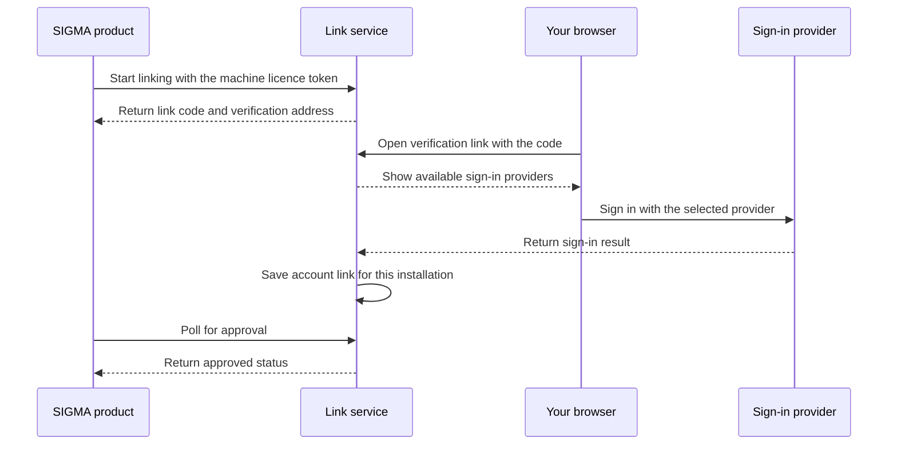

# Account linking

Account linking connects an install key and a machine fingerprint to a sign-in account. It is separate from your store payment.

## Link this installation

1. Start account linking in the product.
2. Open the verification link provided for this request.
3. Check the link code on the verification page.
4. Select a sign-in provider.
5. Complete sign-in at that provider.
6. Wait for the installation to receive approval.

The code has the form `ABCD-1234`. It is not your install key. The link request expires after 10 minutes. If it expires, start a new request.

The link service supports GitHub, Google, and LinkedIn. The verification page shows only providers configured for that service. GitHub linking requires a verified primary email address.

## One link per machine and install key

Each combination of install key and machine fingerprint has one account link. Linking one machine does not link another machine. If you use another install key on the same machine, that installation has a separate link.

The link belongs to the installation. It is not a separate sign-in for each editor window.

## When linking is required

| Licence level | Linking requirement |
|---|---|
| `lax` | Linking is not requested. |
| `remind` | Linking is suggested, not required. |
| `limit` | Linking is required for an unlinked machine ranked beyond the machine allowance. |
| `strict` | Linking is required for every unlinked machine. |

When linking is required, complete it before the deadline. The grace period ends 24 hours after the machine was first seen. After that deadline, an unlinked installation cannot receive new licence tokens.

Read [Licensing](/sigma/licensing/) for the full enforcement rules. Read [Privacy and data](/sigma/privacy-and-data/) for the account information received during sign-in.
