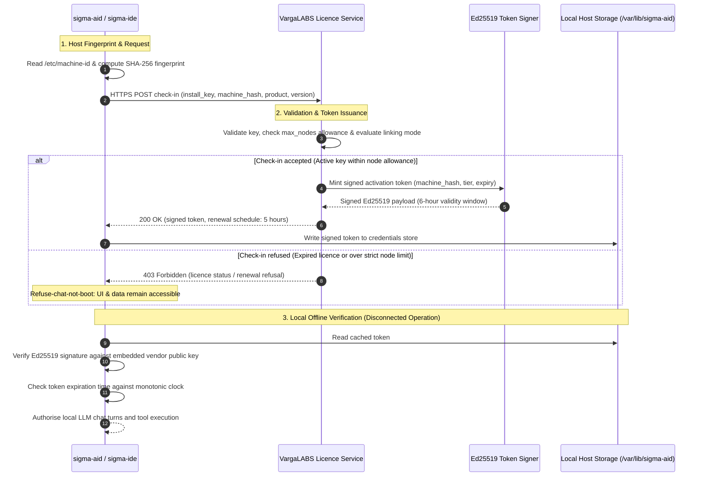

# Licensing & Deployment Editions

The SIGMA platform uses install keys, deterministic machine identification, and cryptographically signed tokens to validate local execution. The system guarantees local autonomy: installations operate offline between token renewals, and the daemon never locks access to local workspaces, configuration files, or session tapes. This page provides the authoritative technical reference for activation mechanics, workstation node allowances, and architecture tiers from single-developer workstations to multi-node enterprise fleets. For live subscription pricing, bundle options, and commercial checkout, visit [the VargaLABS Store](https://store-dev.vargalabs.com/).

## 1. Access Lifecycle: 90-Day Beta, 14-Day Trial & Refuse-Chat-Not-Boot

Access to the SIGMA platform is managed through deterministic runtime enforcement rather than hidden cloud dependencies or remote kill switches. Software instances verify cryptographic validity locally, ensuring that an operator always maintains full control over local workspace files and execution environments.

### 90-Day Public Beta & Founding Cohort Lock

All public beta binary builds carry an embedded 90-day validity window derived from compilation time. During the public beta phase, operators can deploy the complete software suite without upfront payment to evaluate agent coordination, editor integrations, and remote execution tools.

Operators who evaluate beta builds can lock in early pricing by purchasing a commercial subscription during the beta phase. Locking into the Founding Cohort rate on [the VargaLABS Store](https://store-dev.vargalabs.com/) secures lifetime access pricing and includes upcoming staging features from `sigma-lib` (such as team session synchronization and multi-node coordination) at no additional charge.

### 14-Day Free Trial (Starts on First Chat Route)

At General Availability (GA), standalone installations include a 14-day free trial. Crucially, the 14-day trial clock does not begin when the Debian package is downloaded, nor does it begin when the systemd service starts.

The trial clock starts only when the operator successfully configures their first chat connection in Step 1 of the Setup Wizard (such as an Anthropic, OpenAI, or Google OAuth or API key route). This ensures operators can provision Linux user groups, set up POSIX access control lists, configure storage volumes, and verify networking without consuming their trial evaluation window.

### The Refuse-Chat-Not-Boot Guarantee

When a build validity window lapses, a trial period concludes, or a paid subscription expires without renewal, `sigma-aid` enforces the refuse-chat-not-boot guarantee:

1. **The daemon always boots:** `sigma-aid` starts normally under `systemd` and binds to `/run/sigma-aid/sigma-aid.sock` and `127.0.0.1:8742`.
2. **Management surfaces remain operational:** The local Configuration and Setup web UI remains fully accessible for updating credentials, adjusting provider routes, or importing new install keys.
3. **Data preservation:** All SQLite session tapes, vector memories, workspace configuration files, and local git repositories remain intact on disk. The system never deletes, locks, or encrypts operator data.
4. **Selective execution gating:** The daemon refuses only new conversational chat turns and agent dispatches. All read-only commands, session exports, transcript audits, and configuration inspections continue to execute.

## 2. Modular Components & Machine Activation Rules

The SIGMA software suite consists of five modular components that separate the agent execution harness, user interface, remote workstation bridging, and messaging channels.

| Component | Role | Core Harness | Complete Pro | Description |
|---|---|:---:|:---:|---|
| `sigma-aid` | Core Daemon | Included | Included | Local multi-agent runtime, SQLite tape persistence, tool execution sandbox, and POSIX privilege separation. |
| `sigma-ide` | Workbench | — | Included | Full desktop and browser IDE with live multi-agent chat, unified diff inspection, and session telemetry. |
| `sigma-wsd` | SSH Remote Agent | Included | Included | Lightweight remote agent executed on remote Linux hosts over SSH stdio for remote file and shell operations. |
| `sigma-acp` | Editor Bridge | Included | Included | Agent Client Protocol bridge exposing local `sigma-aid` agents directly to Neovim, Emacs, and Zed editors. |
| `sigma-relay` | External Concierge | — | Included | Slack and Discord bidirectional messaging bridge routing external channel mentions to `arthur`, `desk`, and `phone`. |

The **Core Harness** bundle provides terminal and editor-driven automation (`sigma-aid` + `sigma-acp` + `sigma-wsd`), while **Complete Pro** equips operators with the complete 5-module workbench and collaboration suite.

### Workstation Node Allowance (max_nodes)

Every workstation that executes `sigma-aid` or runs a native desktop instance of `sigma-ide` registers an active node against the licence. The activation mechanism derives a non-reversible cryptographic hash from `/etc/machine-id` (salted with the product domain) and transmits the hash during check-in.

- **Core Harness:** Includes 2 workstation node activations (`max_nodes = 2`), enabling concurrent deployment on a primary workstation and a secondary development laptop.
- **Complete Pro:** Includes 3 workstation node activations per seat (`max_nodes = 3`), accommodating an office workstation, home desktop, and portable laptop.
- **Team Edition:** Includes 3 workstation node activations per licensed seat ($3 \times N$).

Active machines are evaluated over a rolling 30-day window. Repeated check-ins from the same `/etc/machine-id` hash do not consume additional slots. Decommissioned machines drop from the active count automatically after 30 days of inactivity.

### Unlimited Passive SSH Targets (sigma-wsd)

Modern software development often spans multiple build servers, cloud instances, and target hardware. Remote targets managed via `sigma-wsd` do not count against your workstation node allowance.

When `sigma-aid` connects to a remote Linux host, it executes `ssh <host> sigma-wsd --stdio` over the authenticated SSH tunnel of the licensed client. Because `sigma-wsd` acts as a passive execution bridge without hosting autonomous agent loops or persistent licensing daemons, operators may connect their licensed workstation to an unlimited number of remote SSH servers, staging containers, and cluster nodes.

### Signed Tokens, Account Linking & Offline Operation

Licence check-ins issue signed cryptographic tokens using Ed25519 asymmetric cryptography. By default, tokens carry a 6-hour validity lifetime. While a token is valid, `sigma-aid` operates entirely offline without making external network calls to the VargaLABS licensing endpoint.

Renewals occur automatically in the background one hour before token expiry when an active network connection exists. Account linking rules dictate token issuance under four enforcement levels:

- **`lax`:** The licence service never prompts for account linking. Valid keys receive signed tokens automatically.
- **`remind`:** The licence service suggests account linking in check-in responses, but issues tokens regardless of linking status (default mode).
- **`limit`:** The service allows unlinked operation up to `max_nodes`. Unlinked machines beyond the node allowance must link an account within a 24-hour grace period from their initial check-in.
- **`strict`:** The licence service requires linked credentials on all active nodes before issuing activation tokens.

## 3. Architecture Matrix: Local vs. Team vs. Enterprise & HPC

The table below outlines architectural capabilities across deployment tiers. Commercial plans can be purchased or reserved on [the VargaLABS Store](https://store-dev.vargalabs.com/).

| Capability / Dimension | 01 // Individual (Local Edition) | 02 // Team Collaboration | 03 // Enterprise & HPC |
|---|---|---|---|
| **Memory & Session Storage** | Local SQLite `✔ Available Now` | Unified Redis, PostgreSQL & MySQL `◇ Staging (sigma-lib) — Included in Founding Lock` | High-Availability Clustered Redis / PostgreSQL / MySQL `◇ Staging (sigma-lib) — Included in Founding Lock` |
| **IDE Deployment Topology** | Local Desktop & Local Browser `✔ Available Now` | Local Desktop OR Centralised HTML IDE on On-Premise Server or AWS EC2 `◇ Staging (sigma-lib) — Included in Founding Lock` | Multi-Node On-Premise / VPC / Air-Gapped Fleet `◇ Staging (sigma-lib) — Included in Founding Lock` |
| **Built-in Live Collaboration** | — | IDE Team Meetings, Screensharing & Live Presentation Mode `◇ Staging (sigma-lib) — Included in Founding Lock` | Meetings, Screensharing, Presentation + Recorded Audit Transcripts `◇ Staging (sigma-lib) — Included in Founding Lock` |
| **External Chat Concierge** | Personal Slack/Discord via sigma-relay `✔ Available Now` | Shared Team Slack/Discord Concierge via sigma-relay `✔ Available Now` | Org-Wide Multi-Channel Concierge `◇ Staging (sigma-lib) — Included in Founding Lock` |
| **Compute & Cluster Scheduling** | Local background jobs via exec_start `✔ Available Now` | Shared build/test lanes `✔ Available Now` | SLURM-Like Distributed Job Manager across compute nodes & GPUs `◇ Staging (sigma-lib) — Included in Founding Lock` |
| **Identity & OS User Management** | Single developer UID `✔ Available Now` | Multi-UID allow_uids / admin_uids `✔ Available Now` | Unified sigma-iam + Linux NSS (nsswitch) or custom identity adapter `◇ Staging (sigma-lib) — Included in Founding Lock` |
| **Access Control & Cryptographic Audit** | POSIX ACLs + SO_PEERCRED `✔ Available Now` | Role-based tool & repo grants (roles.conf) `✔ Available Now` | Private Blockchain-Based ACL + RBAC with Public Verification `◇ Staging (sigma-lib) — Included in Founding Lock` |
| **High-Performance Storage** | Local POSIX + sigma-wsd `✔ Available Now` | Shared workspace volumes `✔ Available Now` | S3-Based Centralised HPC Filesystem (hyperslab) `◇ Staging (sigma-lib) — Included in Founding Lock` |

### 01 // Individual (Local Edition)

Designed for single-operator engineering on a primary workstation and laptop. All session history, memories, vector embeddings, and configuration state reside in local SQLite databases under `/var/lib/sigma-aid/`. Access is restricted to the operator's UID via POSIX domain sockets and ACL permissions.

### 02 // Team Collaboration

Designed for engineering groups sharing codebases, specialized agents, and testing infrastructure. Multiple developer UIDs connect to shared `sigma-aid` instances with distinct permissions configured in `roles.conf`. Team sessions synchronize to shared Redis and SQL backends, with integrated team messaging concierge bridges provided by `sigma-relay`.

### 03 // Enterprise & HPC

Designed for regulated organizations, research laboratories, and distributed high-performance computing clusters. Integrates with SLURM workload managers for GPU task distribution, unifies user authorization with enterprise directory services via Linux NSS, and writes verifiable audit trails to a private blockchain ledger. Centralized storage utilizes S3-compatible hyperslab file arrays for multi-gigabyte data sets.

[Compare plans and claim your 90-Day Beta key on the Store →](https://store-dev.vargalabs.com/)
