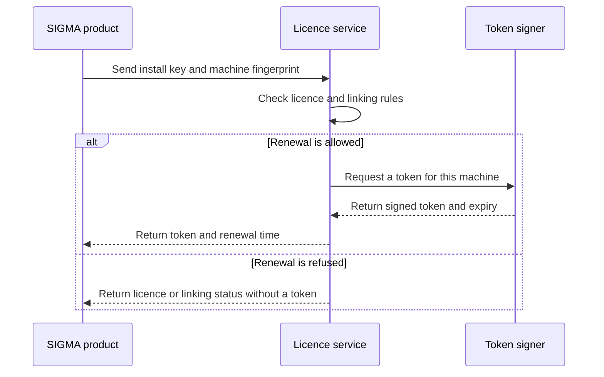

# Licensing

Your install key identifies your licence. A check-in asks the licence service for a signed token for your product and machine.

## Check-in and signed tokens

Check-in sends the install key, a hashed machine fingerprint, and the product name. It can also send the product version and the current token.

The service checks the licence and records when the machine was seen. If the licence is valid and its linking rules allow renewal, the service returns a signed token and a renewal time.

The default token life is 6 hours. A licence can set a different life. A token cannot outlive the licence or a required linking deadline.

The renewal time is before token expiry. Renewal uses the same install key. It does not require another purchase.

## Machines and seats

The machine allowance is called `max_nodes`. A machine counts if its fingerprint was seen in a check-in during the last 30 days. Repeated check-ins with the same fingerprint do not add machines.

Seats are the purchased quantity on a team subscription. The store sends this allowance as `max_seats`. Seats and machines are separate allowances. See [Team setup](/sigma/team-setup/) for the Team formula and examples.

If the active machine count exceeds `max_nodes`, the service records a licence limit violation. This does not by itself stop token renewal. The account linking rules below determine when an unlinked machine must link.

## Account linking rules

A licence can use one of four enforcement levels. These levels control account linking. A revoked or expired licence receives no new token at any level.

| Level | What happens on an unlinked machine |
|---|---|
| `lax` | The service does not request account linking. |
| `remind` | The service suggests account linking. It still issues tokens. This is the default level. |
| `limit` | The service suggests linking within the machine allowance. It requires linking for unlinked machines ranked beyond that allowance. |
| `strict` | The service requires linking on every unlinked machine. |

For `limit`, active machines are ranked by when they were first seen. Earlier machines are within the allowance before later machines.

When linking is required, the grace period ends 24 hours after the machine was first seen. It does not start again when the machine goes over the allowance. Tokens issued during this grace period cannot last beyond the linking deadline.

After the deadline, the service refuses new tokens until the installation is linked. A linked installation does not receive another linking request at any level. Machines over the allowance are still recorded, even if they are linked.

See [Account linking](/sigma/account-linking/) for the sign-in flow.

## Offline use

A stored signed token can be verified offline until it expires. A network connection is needed to obtain a new token. Time offline does not extend a token or the linking grace period.

Reconnect to renew an expired token. The service can issue a new token if the licence is still valid and the linking rules allow it.

## Revocation and expiry

If a licence is revoked, check-in refuses renewal. A token already issued can still verify offline until its own expiry. Revocation does not change the signed token already stored on a machine.

If a licence expires, check-in also refuses renewal. Tokens cannot last beyond the licence expiry time. Renewing a token is not the same as renewing the subscription.

See [Billing](/sigma/billing/) for payment grace and cancellation. See [Privacy and data](/sigma/privacy-and-data/) for the information sent during check-in.
