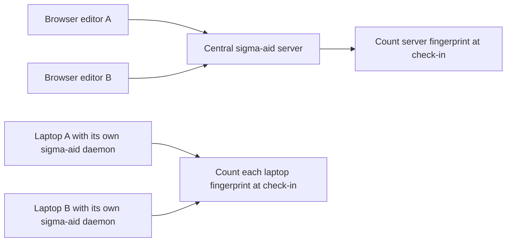

# Team setup

A Team subscription has a purchased seat quantity. The minimum is 3 seats. For N seats, the store sets a machine allowance of 2 × N.

Seats are not machines. Buying another machine is not the same as buying another seat.

## Compare machine counts

The examples below count machines that check in with the team install key.

### Central server

If a central sigma-aid server is the only machine that checks in, it counts as one machine. Editors used in a browser do not add machines to that count unless their machines also check in separately.

### Separate laptop daemons

If each laptop runs its own sigma-aid daemon and checks in, each distinct machine fingerprint counts separately. Use the total across the team install key, not a separate allowance for each laptop.

## Seats and machines

- The purchased seat quantity is sent by the store as `max_seats`.
- The machine allowance is called `max_nodes`.
- Machine counting uses distinct fingerprints seen during the last 30 days.
- Repeated check-ins from the same fingerprint do not add machines.
- A machine that has not checked in during that window no longer counts as active.

The machine total does not change the purchased seat quantity. Use the number of team members when you select the subscription quantity.

## Examples

| Purchased seats | Machine allowance | Example layout within that allowance |
|---|---|---|
| 3 | 6 | One central server that checks in. |
| 3 | 6 | Three laptops that each check in. |
| 5 | 10 | Five laptops and one shared server that each check in. |

In the last example, six machines check in against an allowance of ten. The subscription still has five purchased seats.

Team grants use the `limit` linking level. An unlinked machine ranked beyond the allowance must link an account. It receives no new tokens after its linking grace period ends. Earlier machines are ranked before later machines.

See [Licensing](/sigma/licensing/) for the 24-hour grace period and enforcement details. See [Account linking](/sigma/account-linking/) for the link flow. See [Billing](/sigma/billing/) for per-seat prices.
